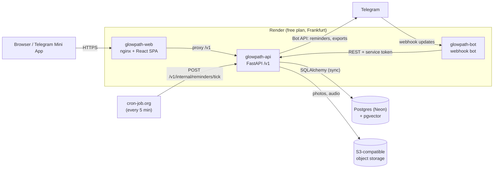

# Architecture

GlowPath is a mood diary that runs as a website and as a Telegram Mini App, with a Telegram bot for quick entries.
This page shows how the pieces fit together and why some design choices were made.
For local setup see [development.md](development.md); for hosting see [DEPLOY.md](DEPLOY.md).

## Components

| Service | Code | Role |
|---|---|---|
| `glowpath-web` | `frontend/` | React SPA (ru/en). nginx serves the static build and proxies `/v1` to the API, so the browser sees one origin. |
| `glowpath-api` | `backend/` | FastAPI under `/v1`. Runs `alembic upgrade head` and seeds built-in content on every start. |
| `glowpath-bot` | `telegram-bot/` | Receives Telegram webhooks and calls the API with `X-Telegram-Bot-Service-Token`. It has no database of its own. |
| Postgres | external (Neon) | All user data. Accessed through the Neon pooler (PgBouncer, transaction mode), so prepared statements are off. |
| Object storage | external, S3-compatible | Photo and audio attachments. The API streams them back to the client after an ownership check. |

## Trade-offs

### Synchronous FastAPI on a threadpool
Endpoints are plain `def` functions using synchronous SQLAlchemy. FastAPI runs them in a threadpool (`anyio.to_thread`, 40 threads by default).
- **Why:** one session and one transaction per request, simple code and simple tests. At the current load async would add complexity without a measurable gain.
- **Cost:** concurrency is capped by the threadpool and, more tightly, by the SQLAlchemy connection pool (default 5 + 10 overflow). A slow external call holds a thread for its whole duration.
- **Note:** correctness under concurrent writes comes from database transactions and constraints, not from the sync model itself.

### Telegram-first sign-in
Users sign in through Telegram: `initData` inside the Mini App, Telegram OIDC in a browser, or a one-time code confirmed through the bot.
- **Why:** the target audience already lives in Telegram, and one sign-in path means fewer support cases.
- **Cost:** no Telegram account, no access. Email and Google sign-in still exist in the code, but they are hidden in the UI and can come back without a rewrite.

### External cron instead of a background worker
Render has no free background-worker plan, so cron-job.org calls `POST /v1/internal/reminders/tick` (Bearer secret) every 5 minutes. Docker Compose still runs a worker locally.
- **Cost:** reminders are accurate to about 5 minutes, and the first tick after idle also wakes a sleeping API.

### Full-text search instead of vector search
Search uses a Postgres `tsvector` column with a GIN index (`russian` configuration). The pgvector column and fastembed code stay in the repo, but `EMBEDDING_ENABLED=false` in production.
- **Why:** a local embedding model does not fit in a 512 MB instance.

### Guest diary in the browser
New visitors can try the diary without an account. Entries are kept in IndexedDB and imported into the account on sign-up.
- **Why:** lower barrier to the first entry, and no server storage for anonymous users.

### Feature flags in code
Flags (`app/core/feature_flags.py`) have a master switch, a percent rollout (stable hash of flag + user id) and allowlists. Paid features are visible only to an allowlist of testers.
- **Cost:** flag targeting lives in environment variables, so changing it needs a restart.

### Migrations on start
The API applies Alembic migrations at container start. This keeps deploys to one step, but a broken migration stops the API from starting, and migrations must stay backward compatible with the previous release while it is still running.

## Known limits
- Free Render services sleep when idle, so the first request after a pause can take tens of seconds.
- 512 MB RAM per service rules out local ML models (embeddings, voice transcription).
- Free services can reach each other only through public URLs.
